# 鲸伴同行 · 页面修复对照表

日期：2026-09-13  |  分支：`fix/page-repair-v2`  |  基线：`3ab2daa`

**阶段：原版实测与方案，业务页面尚未修改。**

本轮沿用原版蓝色渐变、圆角卡片、小白形象和功能顺序。先修逻辑与滚动，再微调“我的”页面。

[打开可筛选、可放大截图的 HTML 对照表](index.html)

| 当前截图 / 位置 | 现在的问题 | 建议怎么改 | 验收标准 |
| --- | --- | --- | --- |
| **R01 全局小屏适配与滚动** P1 · 滚动 · 已复现 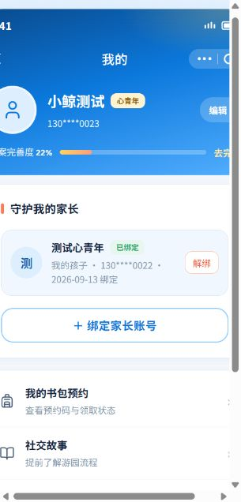 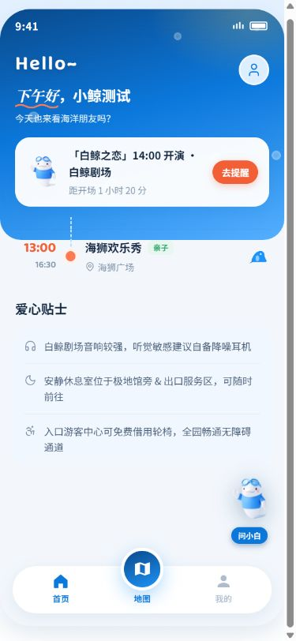 | 320px 宽的视口中，页面仍固定为 375 × 812px，左侧偏移约 −35px，出现横向滚动和文字裁切。首页列表滚动时，时间轴还会进入蓝色头部边界。个人中心存在页面与内容区两层滚动。 | 手机端让页面宽高随视口适配，明确一个主滚动区域；标题区、正文区和底部操作区各占自己的空间，补足底部安全留白。优先修复滚动边界，再调整间距。 | 320/375/390px 手机宽度和桌面预览均无横向滚动；顶部、中部、底部文字完整；底部按钮与正文不重叠。 |
| **R02 “我的”页面视觉微调** P2 · 视觉 · 优化建议 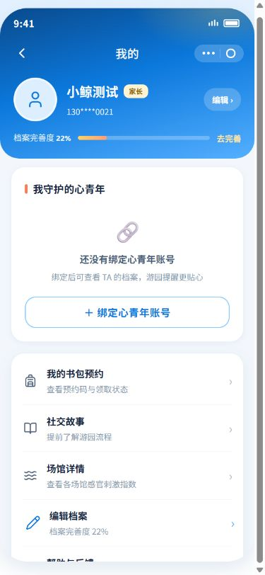 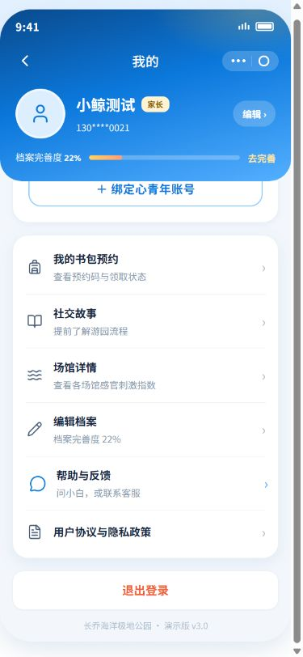 | 空绑定卡片占据较大首屏空间，服务菜单靠下；说明文字和版本文字偏浅，“编辑”和“去完善”两个入口的层级可以更清楚。390px 测试中能滚动到退出登录，不能把正常滚出视口误判为丢失。 | 沿用蓝色渐变头部、头像、进度条和原有服务列表。压缩空状态竖向留白；统一卡片边距、图标大小和行高；提高说明文字对比度，让“完善档案”成为清晰的主要操作。 | 保留原有页面结构和菜单顺序；正文 14–16px、说明至少 12px；服务行触摸区域至少 44px；未绑定和已绑定两种状态都清楚、整齐。 |
| **R03 档案弹窗的填写体验** P2 · 视觉 · 优化建议 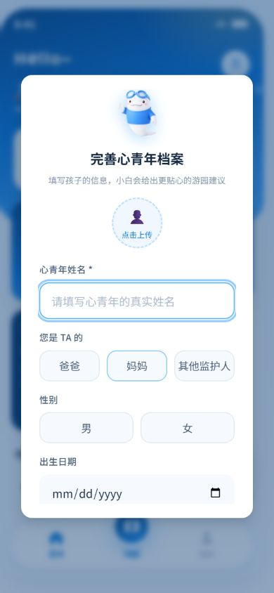 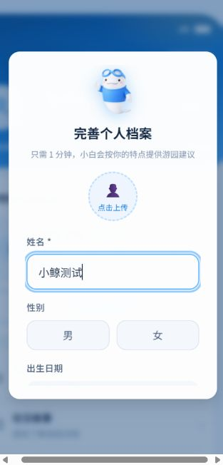 | 弹窗中的字段较长，保存操作需要滚到后面；首次完善与再次编辑使用相同的“保存档案，开始游园／稍后再填”文案。当前已验证能够填写和保存。 | 保留原有字段，压缩顶部装饰留白；让表单内容独立滚动，底部保存区始终可见并预留内容空间。再次编辑时使用“保存修改／取消”，首次填写使用“保存档案／稍后填写”。 | 短屏中可查看最后一个字段，保存区不盖住输入框；取消不覆盖已保存信息；首次填写和再次编辑的文案各自准确。 |
| **R04 列表—详情的返回链路** P1 · 逻辑 · 已复现 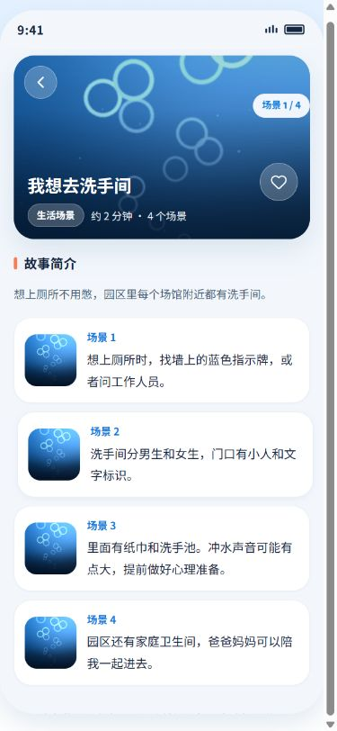 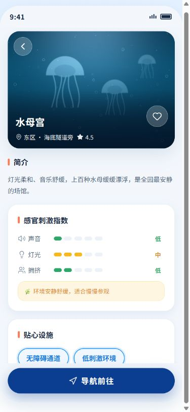 | 进入故事或场馆详情→点击页面返回到列表→再点击列表返回，会重新进入刚才的详情，形成往返循环。返回列表时，之前的搜索词和分类也被清空。 | 统一返回规则：详情回到来时的列表状态，列表回到进入它的首页或“我的”；直接打开详情时提供明确的列表入口。保留搜索词、分类与滚动位置。 | 首页／我的→列表→详情→列表→来源页，连续返回正确；直接打开详情仍能回到列表；浏览器后退与页面返回行为一致。 |
| **R05 地图与“导航前往”入口** P1 · 逻辑 · 已复现 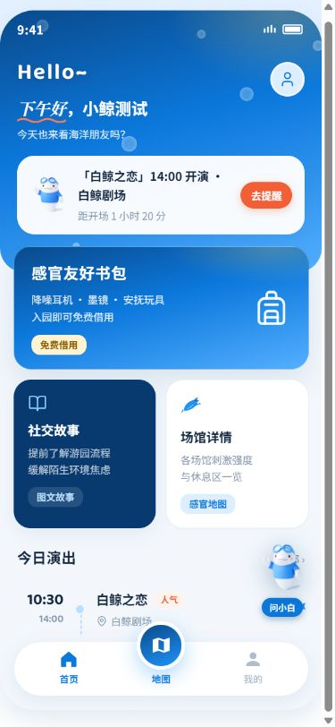  | 首页“地图”和场馆“导航前往”点击后没有页面或提示变化。书包页的地图按钮则只是预告，几处入口的行为不一致。 | 本轮先把常用入口统一为“园区导览”，连接现有场馆列表；场馆按钮改为“查看位置”，展示已有位置描述和休息区信息。书包入口连接同一导览入口，按钮名称与实际结果一致。 | 每个入口都能到达明确内容且能返回；现有静态信息能够完成导览演示。真实园区平面图作为另一个需求，待有底图资料后设计。 |
| **R06 首页演出信息与提醒** P1 · 逻辑 · 已复现  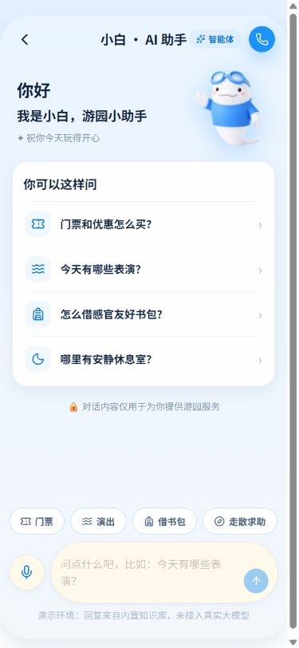 | “去提醒”直接进入助手初始页，没有建立提醒或带入演出问题；“全部”也直接进入助手。横幅一直显示 14:00 和“距开场 1 小时 20 分”，与测试时的下午时间不符。 | 根据现有演出表计算下一场与“即将开始／已结束”；“全部”展示完整演出表。静态阶段把提醒操作改为“查看演出”，进入相应演出信息，相关内容标注为演示排期。 | 按钮文案与落地内容一致；结束后的场次不显示正向倒计时；查看演出后能返回首页。 |
| **R07 账号、档案与绑定状态** P1 · 逻辑 · 已复现 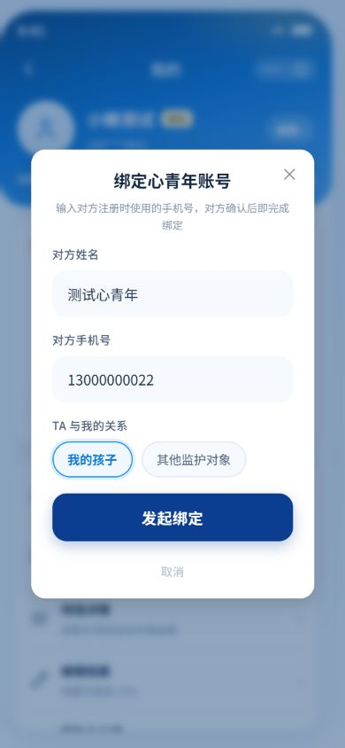 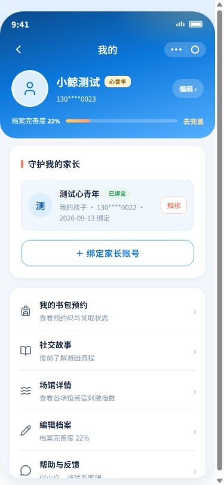 | 账号 A 保存档案、绑定和预约后，退出并注册账号 B，B 仍看到 A 的姓名、关系和预约；甚至在“守护我的家长”下显示“我的孩子”。绑定文案要求对方确认，实际点击后直接显示“已绑定”。 | 按演示账号分别保存档案、关联关系、预约和收藏，退出时清除当前会话。明确区分家长账号与心青年档案；绑定改为清楚的“演示关联”流程，校验本人和重复关联，解除前给出确认。 | 两个演示账号相互切换，数据不串用，切回后各自资料仍在；身份、姓名和关系标签对应正确；操作文案与演示结果一致。 |
| **R08 书包预约成功后的结果位置** P1 · 滚动 · 已复现 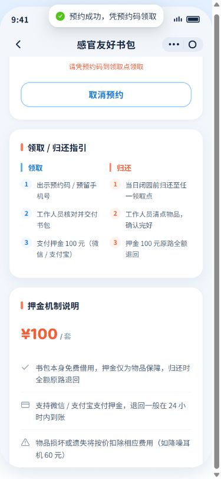 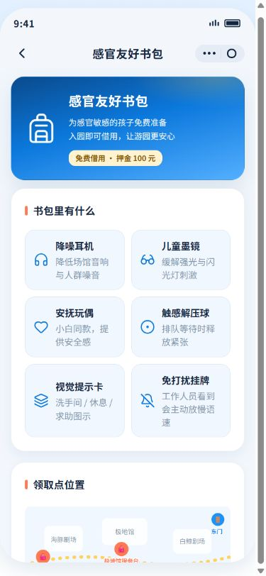 | 在表单下方点击确认预约，表单收起后滚动位置没有同步调整，预约码落在视口上方，画面停在取消按钮和归还说明。“我的书包预约”也先展示长篇介绍。 | 预约成功后将完整结果卡定位到可见区域；从“我的书包预约”进入时优先展示当前预约。卡片清楚显示演示预约码、日期、地点和数量；取消时确认，取消后回到可编辑状态。 | 确认预约后无需额外寻找即可看见完整预约码；刷新仍保留；我的入口直接看结果；取消、再次预约均能完成。 |
| **R09 收藏与列表状态保留** P1 · 逻辑 · 已复现 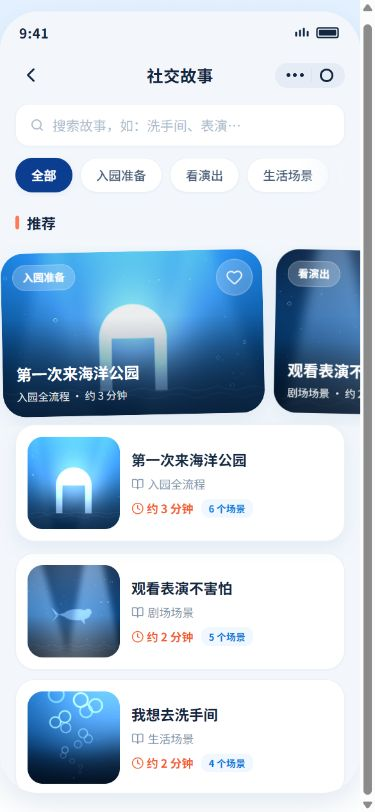 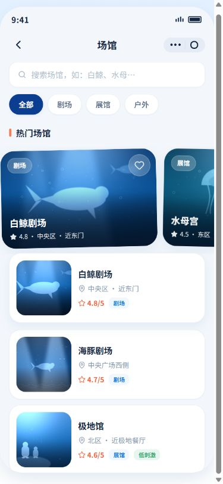 | 故事点击收藏后变为“取消收藏”，刷新后又变回未收藏；列表和详情未共享同一份收藏状态。分类／搜索进入详情后再返回也会丢失。 | 按条目 ID 和演示账号保存收藏，在列表与详情同步。列表内增加清楚的“已收藏”筛选；搜索词、分类和滚动位置随返回恢复。 | 收藏→详情→返回→刷新，状态一致；取消收藏同步生效；“已收藏”可以找到收藏内容；不同账号分别保存。 |
| **R10 助手对话与通话返回** P1 · 逻辑 · 已复现  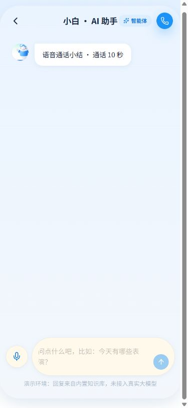 | 发送“今天有哪些表演？”并收到回复，再发起通话、挂断后，原来的文字问答消失，只显示通话小结。离开页面后的对话状态缺少持续保存。 | 在当前演示账号下保存对话；通话小结追加到原会话。保持原有头像、聊天气泡和输入布局，确保最后一条消息可完整滚到输入区上方，并清楚标注模拟通话状态。 | 文字问答→通话→挂断，原消息保留且小结追加；返回和刷新后记录一致；输入框不遮挡最后一条消息。 |
| **R11 登录／注册与协议入口** P2 · 逻辑 · 已复现 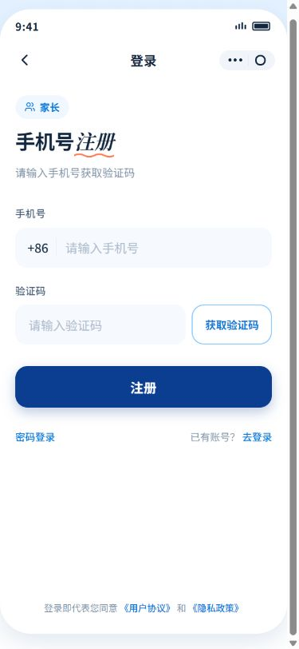 | 注册页正文写“手机号注册”，顶部仍是“登录”，还显示“密码登录”和“登录即代表同意”。登录页协议文字点击无响应；“我的”协议入口也只有演示提示。 | 按登录／注册状态统一页面标题、按钮和辅助文案；协议入口打开可阅读的演示说明，说明当前本地数据用途。正式协议内容另行补齐后替换。 | 注册与登录切换后全部标题和按钮一致；手机号、验证码错误有清楚提示；每个协议入口都有可读内容和返回方式。 |
| **R12 失效链接与空页面** P2 · 逻辑 · 已复现 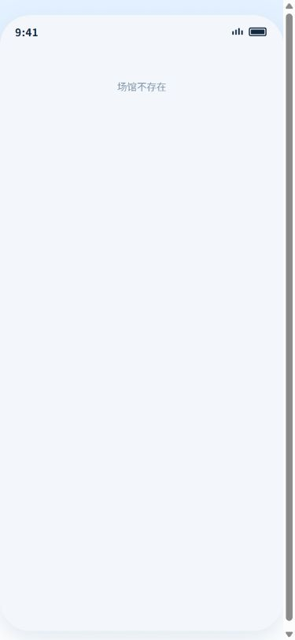  | 无效场馆 ID 只显示“场馆不存在”，没有返回按钮；未知页面地址直接显示空白页。 | 增加统一的空态和页面不存在提示，提供“回到列表／返回首页”；保留简短原因，帮助用户恢复流程。 | 不存在的场馆、故事和路由均能看到明确提示与可用出口；不出现白屏，也不会返回站外。 |

## 复现记录

### R01 全局小屏适配与滚动
- 操作：打开“我的”→切换为 320 × 667；首页→在中部列表向下滚动。
- 依据与边界：浏览器截图与 DOM 尺寸实测；.phone 固定宽度、最小高度，.main-body 的负外边距。

### R02 “我的”页面视觉微调
- 操作：比较“我的”未绑定状态和滚动到底部的页面。
- 依据与边界：原版截图观察；本项为视觉建议，不宣称为功能故障。

### R03 档案弹窗的填写体验
- 操作：注册后进入档案引导；“我的”→编辑，在 320 × 667 下查看。
- 依据与边界：表单实测与截图；真实手机软键盘弹出场景仍需实施时回归。

### R04 列表—详情的返回链路
- 操作：我的→社交故事→生活场景→搜索洗手间→详情→返回列表→再返回；场馆执行同类路径。
- 依据与边界：两类页面均已复现；详情返回使用新增导航记录，列表返回使用历史后退。

### R05 地图与“导航前往”入口
- 操作：首页点击地图；进入水母宫详情点击导航前往。书包地图占位通过代码核对。
- 依据与边界：首页和场馆实测无反馈；代码中场馆导航处理为空，首页未处理 map 分支。

### R06 首页演出信息与提醒
- 操作：首页→去提醒；读取当前时间与横幅文案；核对“全部”的导航处理。
- 依据与边界：浏览器实测＋代码确认横幅为固定文案；此方案未引入真实通知服务。

### R07 账号、档案与绑定状态
- 操作：家长 130****0021 保存小鲸测试→关联 130****0022→预约书包→退出→注册心青年 130****0023→查看我的与书包。
- 依据与边界：端到端实测；截图仅使用本轮生成的虚构演示资料。

### R08 书包预约成功后的结果位置
- 操作：我的→书包预约→滚到表单底部→确认预约；刷新并从我的重新进入。
- 依据与边界：实测截图显示结果卡上部被当前滚动位置裁掉；预约刷新保留已通过。

### R09 收藏与列表状态保留
- 操作：故事推荐卡收藏→刷新；筛选生活场景并搜索→详情→返回。
- 依据与边界：故事已实测；场馆复用相同收藏组件，实施后需对两类内容分别回归。

### R10 助手对话与通话返回
- 操作：首页→去提醒→发送今天有哪些表演→收到回复→发起语音通话→挂断。
- 依据与边界：入口、内置回复、挂断及返回实测；麦克风权限、真实录音识别与音频质量未测试。

### R11 登录／注册与协议入口
- 操作：身份选择→注册；登录输入 123→获取验证码；点击用户协议。
- 依据与边界：实测：手机号格式校验有效，协议点击无反馈；个人中心协议入口通过代码核对。

### R12 失效链接与空页面
- 操作：直接打开 /venues/not-found 和 /not-found。
- 依据与边界：两个场景已实测；故事失效 ID 在实施回归中一并覆盖。

## 首轮测试

| 模块 | 操作 | 结果 | 观察 |
| --- | --- | --- | --- |
| 身份选择 | 未选择身份点击登录 | 通过 | 弹窗要求先选择身份 |
| 登录校验 | 手机号填 123 后获取验证码 | 通过 | 提示 11 位手机号格式错误 |
| 家长注册 | 演示验证码注册并打开档案引导 | 通过 | 注册成功，可填写档案 |
| 档案保存 | 填写姓名、关系、听觉偏好并保存 | 通过 | 首页和我的更新资料 |
| 心青年注册 | 第二个演示账号注册 | 有问题 | 可注册，但引导预填前一个账号资料 |
| 常用入口 | 首页／我的→书包、故事、场馆、助手 | 通过 | 均可到达对应页面 |
| 地图与导航 | 首页地图、场馆导航前往 | 有问题 | 点击没有反馈 |
| 演出提醒 | 去提醒和演出横幅 | 有问题 | 进入空白助手，倒计时为固定文案 |
| 正常返回 | 我的→书包→返回 | 通过 | 返回我的 |
| 书包预约 | 确认、刷新、重新进入 | 有问题 | 可生成并保留结果，成功后预约码不在可视位置 |
| 故事搜索 | 分类生活场景＋关键词洗手间 | 通过 | 结果匹配目标故事 |
| 场馆搜索 | 分类展馆＋关键词水母 | 通过 | 按名称／位置描述过滤 |
| 详情阅读 | 故事向下滚动 | 通过 | 场景计数更新到 4/4 |
| 故事返回 | 详情→列表→返回 | 有问题 | 重新进入刚才的详情，筛选丢失 |
| 场馆返回 | 详情→列表→返回 | 有问题 | 重新进入刚才的详情，筛选丢失 |
| 收藏 | 故事收藏→刷新 | 有问题 | 收藏状态丢失 |
| 绑定演示 | 发起绑定 | 有问题 | 文案要求对方确认，操作立即显示已绑定 |
| 账号切换 | 家长账号→心青年新账号 | 有问题 | 档案、关系、预约串用 |
| 助手回复 | 询问今天有哪些表演 | 通过 | 内置知识库返回演出安排 |
| 通话返回 | 文字问答→通话→挂断 | 有问题 | 文字问答消失，仅保留通话小结 |
| 个人中心滚动 | 390 × 844 滚到底部 | 通过 | 可以到达退出登录与版本文字 |
| 小屏适配 | 320 × 667 查看我的与档案弹窗 | 有问题 | 固定 375px 宽导致裁切和横向滚动 |
| 协议 | 登录页用户协议文字 | 有问题 | 点击无响应 |
| 失效地址 | 无效场馆与未知路由 | 有问题 | 缺少退出入口／白屏 |
| 真实语音与手机键盘 | 麦克风、识别、音频质量、软键盘 | 未测 | 本轮为桌面浏览器静态演示测试 |

## 范围与实施顺序

1. 返回、账号隔离、收藏、会话保留。
2. 小屏与滚动边界、预约结果位置。
3. 入口反馈、演出信息、登录文案、失效链接。
4. 沿用原版结构，微调我的页面与档案弹窗。

已在桌面浏览器测试 390 × 844、320 × 667 两种视口；375px 和桌面宽屏列为实施后回归。真实麦克风、录音识别、音频质量和手机软键盘未测。账号和资料均为本轮虚构测试数据。

当前仓库仅有构建产物与 UI 稿件，构建包中的 src 路径不是已提供的源码。实施前需确定保留现有结构的局部修改方式。

本轮没有接入真实账号、短信、支付、地图或通知服务；业务代码与 main 基线一致。
