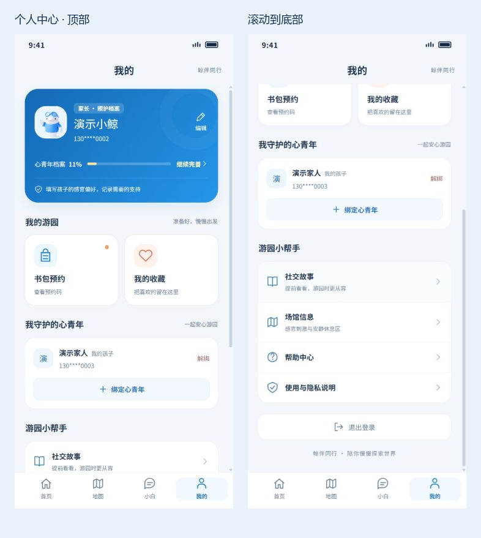

# 静态 Demo 修复与验证记录

日期：2026-09-13。分支：`fix/navigation-profile-ui`。范围：现有静态页面的导航、状态、滚动和个人中心视觉优化。

## 修复结果

| 项目 | 原实现中的问题 | 本次调整 |
|---|---|---|
| 页面滚动 | 固定 812px 高度，小屏内容易裁切；首页内容负边距与顶部重叠 | 手机跟随可视高度；滚动区 `min-height: 0`，统一底部留白；移除首页负边距 |
| 个人中心 | 绑定空态占据大量首屏空间，菜单层级和滚动区域不清晰 | 重排档案卡、常用服务、家人陪伴、帮助设置；顶部与底部导航在滚动区外 |
| 首页地图 | 点击无响应 | 打开静态场馆分区与服务点指引 |
| 演出入口 | 横幅和“全部”跳到聊天，倒计时写死 | 跳到演出列表；按当前时间选择下一场，结束后显示结束状态；演出条目可打开对应场馆 |
| 场馆详情 | “导航前往”为空操作，图集显示不存在的“6+”数量 | “查看位置指引”携带目的地跳转；显示实际已有图集 |
| 返回与无效链接 | 直接进入页面时返回可能离开应用；未知路由空白 | 增加应用内返回兜底和不存在页面，提供返回列表/首页按钮 |
| 搜索 | 返回详情前的列表会丢失搜索条件；筛选后推荐内容仍混在结果中 | 搜索与分类存入 URL，返回后保持；筛选时隐藏推荐区域 |
| 登录与注册 | 注册标题显示登录；验证码未绑定手机号；切换账号可能混用资料 | 修复标题、验证码手机号与有效期校验；按手机号和身份隔离演示数据 |
| 退出登录 | 只跳到身份选择页，没有清除活动身份 | 保存当前账号数据后清除活动身份；同账号重新登录恢复档案和预约 |
| 档案编辑 | 取消草稿后再次打开仍残留草稿，日期和电话缺校验 | 打开时重置为已保存档案；校验姓名、生日、紧急电话；头像缩小后保存，提供存储失败反馈 |
| 家人绑定 | 可重复或绑定自己，文案暗示真实邀请已完成 | 增加自绑定/重复校验、解绑确认；明确本机演示绑定；区分家长的照护档案 |
| 收藏 | 爱心只改变当前组件状态，刷新失效 | 按故事/场馆 ID 本地保存，列表与详情同步；个人中心提供收藏列表 |
| 书包预约 | 日期使用 UTC，凌晨可能差一天；取消无确认，数量边界无禁用 | 按本地日期生成；校验日期与存储数据；数量 1–3，取消需确认；刷新后保留 |
| 聊天与通话 | 切页丢聊天，“停止回复”无回调，语音失败会伪造识别文字，挂断回退容易回到通话 | 保留当前会话聊天；支持停止回复；语音不可用明确提示；挂断返回聊天并保留小结；关闭扬声器停止当前朗读 |
| 样机 | iframe 使用站点根路径，在子目录部署会加载错页面 | 按 `mockup.html` 所在目录定位入口 |
| 可维护性 | 只有压缩发布包 | 增加 JSX、样式、状态逻辑、格式化应用函数和可重复构建脚本，保留原始包与校验值 |

## 验证

- `npm test`：11 项逻辑回归全部通过，包括账号隔离/恢复、生日边界、本地日期、重复绑定、档案校验和返回兜底。
- `npm run build`：通过，原始基线 SHA-256 校验及产物语法解析通过。
- `npm audit --audit-level=low`：0 项漏洞（新增开发依赖）。
- 浏览器检查 18 条页面路径，包括三个不存在页面；没有空白页、已完成加载但损坏的图片或应用控制台错误。
- 记录 23 项交互检查，包括地图/演出/目的地跳转、收藏与预约刷新、搜索空态与返回、绑定校验、登录退出与恢复、聊天停止和通话返回、样机子目录加载。
- 9 类页面在 **320×568、393×852、1440×900 CSS 像素**下检查，共 27 组，无页面/内容横向溢出或手机容器超出视口。
- 个人中心滚动到底部时，页尾文字完整位于底部导航上方；320px 小屏档案弹窗的保存按钮可滚动到达并操作。
- Windows 显示缩放为 110%，工具请求的像素尺寸与 CSS 视口尺寸不同。记录中保留了两者；`profile-overview.png` 仅裁去原始截图外围未绘制的白边，其余原始截图完整保留。

原始检查数据：[browser-checks.json](browser-checks.json)。截图中的姓名和手机号均为专用演示数据。

## 验证边界

本轮验证针对静态演示。语音页面的开始展示、扬声器、挂断返回、录音效果取消已检查；真实麦克风识别和不同浏览器的语音引擎未作兼容性认证。地图为静态位置说明，未实现实时定位。真实短信、AI 接口、支付、跨设备同步及现场服务不在本轮范围。

问卷/行后反馈及五感测评报告保持待迭代状态，未将帮助中心视为反馈闭环完成。

## 新版界面

- [320px 档案弹窗](profile-modal-320.png)
- [320px 弹窗滚动到底部](profile-modal-320-bottom.png)
- [样机预览](profile-mockup.png)
